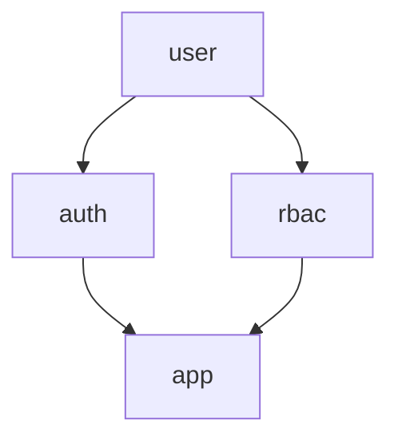

# webtyp/auth


Authentication mechanisms, sessions, identities, and OAuth providers for the
WebTyp ecosystem. Authorization belongs to `webtyp/rbac`. Both are siblings
that depend only on `webtyp/user` and never on each other.

> **BREAKING CHANGE**: `StateStore.CreateState` and `StateStore.ConsumeState` changed signatures to support browser-bound OAuth state nonces:
> - `CreateState(provider string) (state, nonce string, err error)`
> - `ConsumeState(state, nonce, provider string) error`
>
> Known consumers to update: `oauth2/oauth.go` (updated in this repo) and any custom implementations of `auth.StateStore`.



## Documentation

- [Architecture](docs/ARCHITECTURE.md) — Dependency rules, packages, local simulator

## Packages

- `auth` — Core ports: `SubjectStore`, `SessionIssuer`, `IdentityStore`,
  `StateStore`, `SecurityNotifier`, `SessionRepo`, `Config`, `ProfileDTO`,
  `ShellProfile`, OAuth types.
- `authority` — Concrete module (`Module`) implementing the ports, caches,
  migrations, and middleware. Configures a secure opaque cookie session strategy by default using 256-bit CSPRNG entropy (`webtyp/crypto/rand`) for session IDs and OAuth states.
- `oauth2` + `oauth2/provider/google`, `oauth2/provider/microsoft` — OAuth flow
  and providers.
- `session/cookie` — Session transport: an opaque cookie over the session table, with a per-session `SessionPolicy` (absolute cap, idle limit, assurance).
- `passkey` — WebAuthn authenticator: enrollment and a step-up session (`AssuranceMultiFactor`) after a verified passkey.
- `clientassertion` — Machine clients: `private_key_jwt` (RFC 7523) bearer assertions become principals.
- `cfaccess` — Cloudflare Access: identifies each request by the signed `Cf-Access-Jwt-Assertion` (RS256, issuer, audience), mapping the verified e-mail to a user.
- `email_password`, `trusted_ip` — Credential authenticators.
- `local` — Development selector authenticator; no network, no env vars.

## Local door and internet door

An app served on two ports (`webtyp/server`: `Config.Port` is the local door, `Config.InternetPort` the
internet one, e.g. behind Cloudflare Tunnel) marks each request (`router.FromInternet(ctx)`; an unmarked
request counts as internet). On the internet door:

- the RUT login (`auth.PathLoginRUT`) and the first-admin setup (`auth.PathSetup`) answer 404;
- passkey enrolment (`passkey.PathRegisterOptions`, `passkey.PathRegister`) answers 404 — a passkey is
  registered only from the local door, so a stolen RUT on the internet can never add one;
- a passkey alone is a login: `passkey.PathVerifyOptions` and `passkey.PathVerify` work without a prior
  session (the user comes from the stored credential) and issue the step-up session
  (`model.AssuranceMultiFactor`), the only kind the internet door accepts for non-public routes.

Login challenges asked for without a session are single use, expire after 5 minutes, and the expired
ones are deleted each time a new one is asked for.

## Sessions

`TokenTTL` is the **absolute** lifetime of the default strategy's sessions: an
active session still ends after it. `IdleTTL` is the idle limit within it.
The default cookie is **host-only** and named `__Host-<CookieName>`, so no
sibling subdomain can set or shadow it. **Upgrade note:** existing sessions are
dropped once on deploy (the cookie name changed and rows carry a new policy).

## Bank-grade setup

An SSO identity shared by every subdomain (single factor), plus a host-only
step-up session proven by a passkey, plus machine clients:

```go
authMod, _ := authority.New(db, auth.Config{IDs: ids}) // host-only default cookie

sso, _ := cookie.New(authMod, cookie.Options{
    Name: "sso", Domain: ".velty.cl",
    Policy: auth.SessionPolicy{Absolute: 43200, Idle: 1800, Assurance: model.AssuranceSingleFactor},
})
authMod.SetStrategy(sso)

stepUp, _ := cookie.New(authMod, cookie.Options{ // host-only: __Host-admin
    Name: "admin",
    Policy: auth.SessionPolicy{Absolute: 8 * 3600, Idle: 900, Assurance: model.AssuranceMultiFactor},
})
authMod.SetStepUpStrategy(stepUp)

pk, _ := passkey.New(db, ids, authMod, server.RelyingParty{ID: "iam.velty.cl", Origin: "https://iam.velty.cl"})
ca, _ := clientassertion.New(db, clientKeys, "https://iam.velty.cl", authMod.Notify)
authMod.Enable(pk, ca)
```

Routes marked `.RequiresMFA()` answer a single-factor caller with 401 and the
RFC 9470 challenge; the client then runs `passkey` verify to get the step-up
session. Run `passkey.Migrate` and `clientassertion.Migrate` next to
`authority.Migrate`. Logout revokes both sessions.

## Working without the server (remembered session)

An offline-first app lets the person who signed in keep working on the same device, that same day,
while the server is unreachable. No new sign-in ever happens offline, and the remembered profile
grants nothing: the server re-authorises every request it receives.

```go
store := localStore{} // Get/Set/Del over dom.LocalStorageGet/Set/Del
day := time.FormatDate(time.Now())
if err == nil {            // "me" answered
	auth.RememberSession(store, profile, day)
} else if p, ok := auth.RememberedSession(store, day); ok { // no answer from the server
	profile = p
}
// on sign-out: auth.ForgetSession(store)
```

## Local Development

```go
scenarios := []local.Scenario{
    {ID: "user_admin", Name: "Alice", Email: "alice@example.com", Avatar: "", Roles: []string{"Administrator"}},
    {ID: "user_viewer", Name: "Bob", Email: "bob@example.com", Avatar: "", Roles: []string{"Viewer"}},
}
_ = authority.Migrate(db.RawConn(), db.RawConn().(ddl.Compiler))
authMod, _ := authority.New(db, auth.Config{IDs: ids})
rbacSvc, _ := rbac.New(db)
// seed subjects and assignments via rbac before mounting
for _, s := range scenarios { /* ensure user and AssignRole via rbacSvc */ }
localAuth := local.New(scenarios, authMod, authMod, local.WithAfterLogin("/"))
authMod.Enable(localAuth)
```

### LAN RUT Login Example

A LAN app identifies staff by RUT and checks the request's IP. Configure the
module first, then enable the mode — `Enable` registers on the module you built:

```go
authMod, _ := authority.New(db, auth.Config{
    IDs:     ids,
    IdleTTL: 1800, // 30 min without activity ends the session (sliding); TokenTTL (default 24 h) is the absolute cap
    Permissions: &auth.Permissions{
        Grants:    rbacSvc, // satisfies auth.GrantLister structurally
        ProjectID: "main",
    },
})

// trustProxy is explicit, not an Option: behind a reverse proxy every request
// otherwise looks like it came from the proxy's own IP.
authMod.Enable(trustedip.New(authMod, trustedIPStore, authMod, authMod, false))
```

The client builds its single-field login form from `auth.RUTLoginDataModel` and
posts it to `auth.PathLoginRUT`. `trustedIPStore` is the consumer's
`auth.TrustedIPStore` — answer it per user, not per network, or anyone inside
the LAN can log in as anyone else.

Administering which RUT belongs to which user goes through the `register_lan`,
`unregister_lan` and `get_lan` operations, gated on `auth.ResourceLANIdentity`.
Grant that resource only to LAN administrators: registering a RUT mints a login
credential, which is a different privilege from editing user records.

> **Not yet supported: users without an email.** `CreateUser("", …)` writes an
> empty string, and a second one fails with `ErrEmailTaken` because the column
> is `Unique`. See `docs/PLAN.md` stage 4 — it is blocked on the
> `NULLABLE_COLUMNS` wave, not on this module.

Production builds use `oauth2.New` with a real `google.GoogleProvider` and never
register `local`.

## Development auto-login

In development environments, setting `DEV_AUTOLOGIN` automatically opens a real session on unauthenticated requests so you don't have to re-login every time the server restarts or times out.

The value must be the **exact JSON body** that the login form POSTs:
- For `trusted_ip`: `DEV_AUTOLOGIN={"code":"12345678-5"}`
- For `email_password`: `DEV_AUTOLOGIN={"email":"admin@example.com","password":"secretpassword"}`

The auto-login goes through the exact same validation path as a normal POST request (including IP allowlists, active account status, and rate limits). If logging in from that machine would fail, auto-login fails too.

Once rejected, auto-login latches off in that process to prevent rate limit starvation; to retry, restart the server. To view the actual login form, clear the variable and restart the server.

`DEV_AUTOLOGIN` is opt-in at build time: the dev server must be built with `-tags dev` (the `webtyp` dev environment does this). Any other build ignores the variable entirely.
