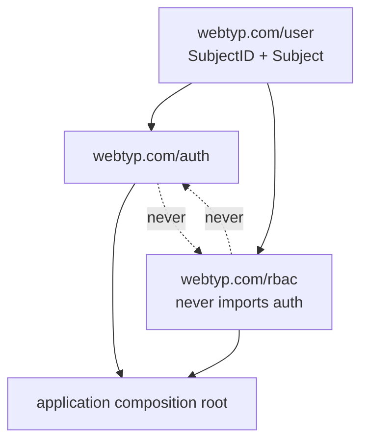
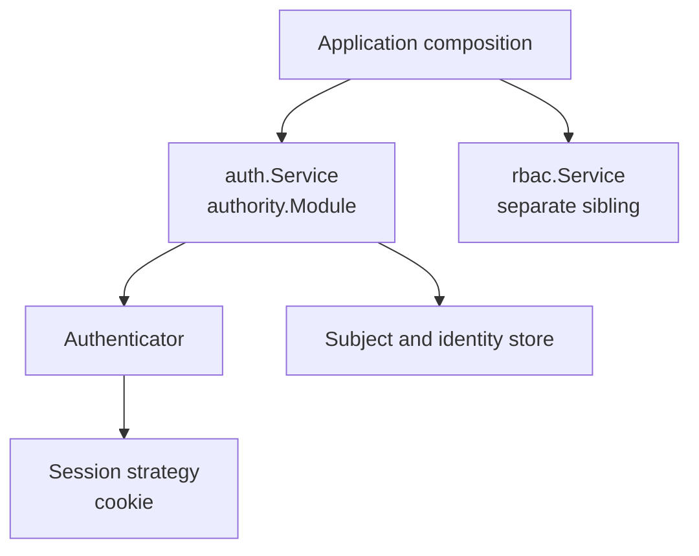
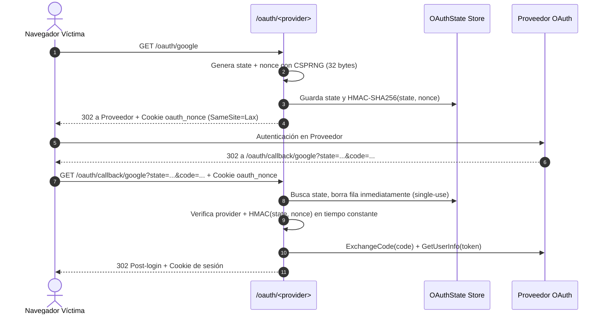

# Architecture

`webtyp/auth` owns authentication mechanisms: subjects and their external
identities, login flows, session lifecycle, OAuth state, and concrete providers.
It depends on `webtyp/user` only for the stable `Subject` value contract.

It never decides roles or permissions. Applications compose its authentication
middleware with `webtyp/rbac` explicitly. `auth` and `rbac` are siblings;
neither imports the other.

## Dependency Direction



Rules:

- `user` imports neither `auth` nor `rbac`.
- `auth` imports `user`; it may depend on `orm`, `fetch`, `jwt`, `sqlite`,
  `crypto`, and provider packages. It never imports `rbac`.
- `rbac` imports `user`; it may depend on its own persistence. It never imports
  `auth`.
- Only the composition root imports both.

## Packages

- `auth`: the contract. `Mode` (a sign-in mode as the app chooses it), `Ports` (the pieces every mode receives),
  `ModeWithTables` and `MigrateModes`, `Authenticator`, and the login ports (`SubjectStore`, `SessionIssuer`,
  `IdentityStore`, `StateStore`, `SessionRepo`, `StepUpIssuer`, `PrincipalReader`).
- `authority`: concrete `Module` implementing the ports; knows no mode. Owns the data models (`user`, `session`,
  `identity`, `oauth_state` tables), mounts `user` and `me` through `crud`, serves sign-out, gives the modes their
  `Ports()` and the browser `ReadMe`/`SignOut`,
  and the session cache. The session cache
  is strictly read-through (`GetSession` loads on miss) and is intentionally not
  pre-warmed on module construction to avoid costly table scans in short-lived isolate
  environments. Schema DDL is reconciled explicitly via `authority.Migrate` at deploy
  time; `New` assumes the schema already exists and performs no database queries.
- `oauth2`: OAuth authorization-code flow (begin/callback, state handling).
- `oauth2/provider/*`: concrete Google and Microsoft protocol adapters.
- `session/cookie`: the session transport (opaque cookie, per-row `SessionPolicy`).
- `passkey`: WebAuthn authenticator; a verified assertion issues the step-up session. The step-up session exists by default (cookie `__Host-stepup`, same lifetimes as the main one, `AssuranceMultiFactor`) and `SetStepUpStrategy` only changes it.
- `clientassertion`: `private_key_jwt` machine clients (`RequestIdentifier`).
- `cfaccess`: Cloudflare Access `RequestIdentifier`. Trusts only the signed token, maps the e-mail to a user (via an identity row, or `UserByEmail` plus a new link). It never issues a session. Enable only on the tunnel listener if another mode trusts IPs.
- `email_password`: email+password credential authenticator.
- `trusted_ip`: RUT + IP allowlist authenticator.
- `local`: deterministic development login scenarios; it never contacts Google,
  never uses `fetch`, and has no environment variables.



## Local Simulator

`auth/local` receives an explicit slice of immutable `Scenario` values (stable
subject identifier, display name, email, avatar, display role labels), an
`auth.SubjectStore`, an `auth.SessionIssuer`, and an explicit `AfterLogin`
route. It exposes `ProviderName`, `PathStart`, and `PathSelect`. The GET route
serves a minimal selector; the POST route validates the identifier against the
configured slice, rejects unknown/empty with a deterministic 400, resolves or
creates the identity through `SubjectStore`, calls `SessionIssuer.IssueSession`,
and redirects to `AfterLogin`. It never assigns roles.

## Credenciales portadoras

Cualquier valor en el sistema que actúe como credencial portadora ( bearer credential ) debe ser completamente impredecible y generarse mediante el CSPRNG del ecosistema (`webtyp.com/crypto/rand`). No se utilizan generadores de identificadores correlativos o basados en tiempo (`ids`) para este tipo de valores.

| Campo / Valor | Origen de Aleatoriedad | Razón |
|---|---|---|
| `User.Id` | `ids` (`unixid`) | Clave primaria interna, no viaja como credencial. |
| `Identity.Id` | `ids` (`unixid`) | Clave primaria interna de relación con proveedor. |
| `LANIP.Id` | `ids` (`unixid`) | Clave primaria interna de IP permitida. |
| `Session.Id` | `rand` (`SecretN(32)`) | Credencial portadora enviada en la cookie de sesión. |
| `OAuthState.State` | `rand` (`SecretN(32)`) | Token anti-CSRF enviado al proveedor OAuth. |
| OAuth Nonce | `rand` (`SecretN(32)`) | Token ligado al navegador enviado en cookie `oauth_nonce`. |

## El intercambio OAuth

Para prevenir ataques de login-CSRF (donde un atacante fuerza a una víctima a consumir el `code` del propio atacante), el parámetro `state` enviado al proveedor de identidad se vincula de forma estricta al navegador que inició la sesión mediante un `nonce` en cookie.



## Security Events

`authority.New` requires `Config.Events` (the app's broker) and builds a `securityevent.Reporter` over it; every mode
receives it in `Ports.Report` and reports with the shared vocabulary of `webtyp.com/securityevent` (OWASP names):
a refused sign-in is `LoginFailed` with its `Reason` (`unknown RUT`, `device not trusted`, `wrong setup code`…), a
rate-limited attempt `RateLimited`, the first administrator `AdminCreated`, an unreadable administrators store
`SecurityStoreFailed`. An event never carries what the person typed, a password, a token or a session id.

## Who the caller is: the crud entity `me`

The browser asks who it is with a crud read of `me` (`router.Operation{Module: "user", Entity: "me", Action: model.Read}`, served as `/api/user/me`), like any other data: it is never a raw route. The rule (`authority/rule_me_read.go`) takes the caller from `crud.CurrentUser`, ignores any filter and answers one row, so nobody reads another person's profile. Any signed-in person may read it: `authority.DefaultGrants` holds that grant and the composition root applies it to `rbac.RoleAuthenticated`; without a session there is no subject and the read is refused. It composes identity with authorization in-library when `Config.Permissions` is provided:
```go
authMod, _ := authority.New(db, auth.Config{
    IDs:    ids,
    Events: broker,
    Permissions: &auth.Permissions{
        Grants:    rbacSvc, // satisfies auth.GrantLister structurally
        ProjectID: "main",
    },
})
```
Each grant travels as `me.grants[]`: `{resource, actions}` with actions as `model.Action.String()` writes them (`"crud"`, `*` for every resource); the client parses them with `model.ParseAction` and evaluates `model.Grant.Matches`, the same rule as the server.

## Session policy

Each session row carries its own `SessionPolicy`: `AbsoluteAt` (hard cap), `IdleSeconds` and `Assurance`. `GetSession` ends a row when `now >= ExpiresAt` or `now >= AbsoluteAt`; otherwise it slides `ExpiresAt` to `min(now+IdleSeconds, AbsoluteAt)`, persisting only when the move is at least 60 s. `Config.TokenTTL` is the absolute cap of the default strategy and `Config.IdleTTL` its idle limit (0 = none).

`Authenticate()` resolves, in order: a `RequestIdentifier` that handled the request, the step-up session (MultiFactor), the main session (SingleFactor), dev autologin (`-tags dev`), anonymous. It sets `ctx.SetUserID` and `ctx.SetAssurance`. The only raw routes are the ones that set or clear the session cookie (login, logout, first setup); everything else is a crud operation.

## Sign-in modes and the first administrator

`trusted_ip` owns the RUT (`RegisterRUT`, `UnregisterRUT`; the link is an `Identity` of provider `trusted_ip`) and
asks the app's register of devices (`trustedip.Mode{Devices}`, found with `Ports.Built`) which IP each person may use.
`email_password` owns the hash (`SetPassword`, `CheckPassword`). The first administrator is common to every mode:
`Ports.HasAdmin` says whether one exists and `Ports.MakeAdmin` gives the role; `trusted_ip` creates it from the local
network, `passkey` with a one-time code written in the server log (it serves once and locks after five wrong tries).
From the local network `GET /setup` answers 200 `{"required":true|false}` or 503 when the administrators cannot be
read; from the Internet, 404.

## Email-less users

LAN staff are users without e-mail (the column stores NULL, so it stays unique). `UserByEmail("")` always
returns `ErrNotFound`, because an empty e-mail is not a lookup key: `oauth2`'s callback links the caller's provider identity to whatever
`UserByEmail` returns, so a provider reporting a verified-but-empty address
would otherwise take over the first account with no email.

`ListUsers()` lists every user, with or without e-mail.


## The internet door

Through Cloudflare Tunnel every visit reaches the server from `127.0.0.1`, which the first-admin setup
assigns to the admin's device, and `X-Forwarded-For` is forgeable: on the internet door the IP proves
nothing. So `trusted_ip` (RUT + registered device) and the setup do not exist there, and enrolling a
passkey is local only (registering the second factor only from a trusted location, as Microsoft Entra
Conditional Access allows: https://learn.microsoft.com/en-us/entra/identity/conditional-access/policy-all-users-security-info-registration).
Before login there is no session to hold the challenge, so a login challenge is stored without a user
and found by its own random, single-use value (`webauthn/server.UnverifiedChallenge`); `VerifyAssertion`
still checks it against the signed client data.
