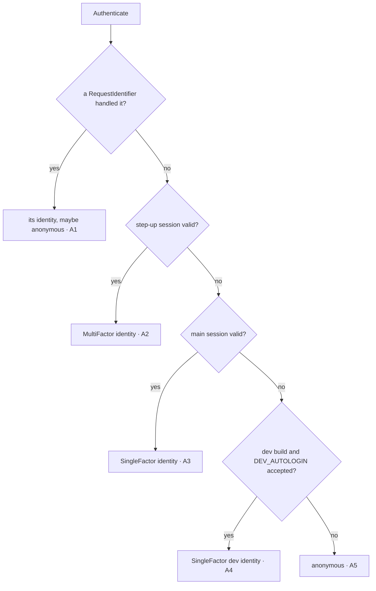
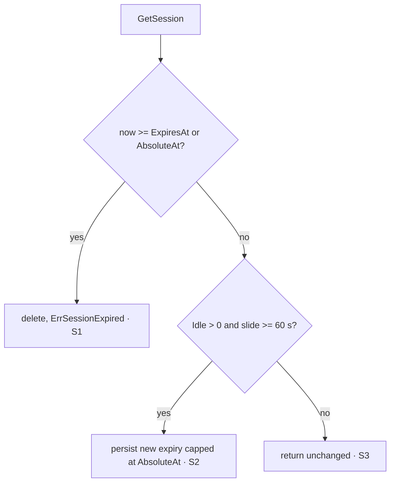
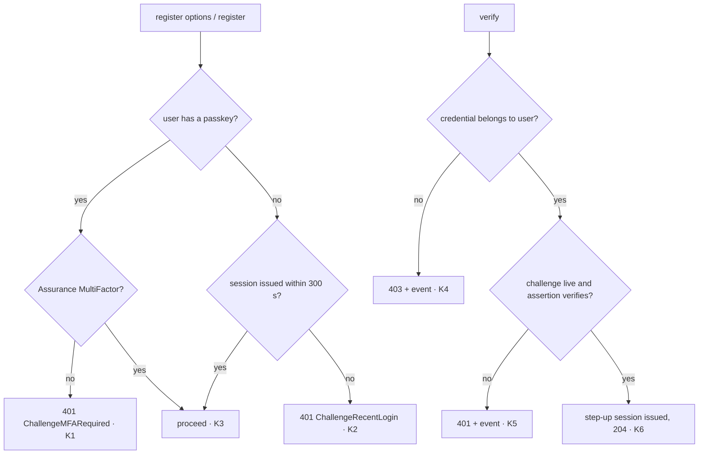
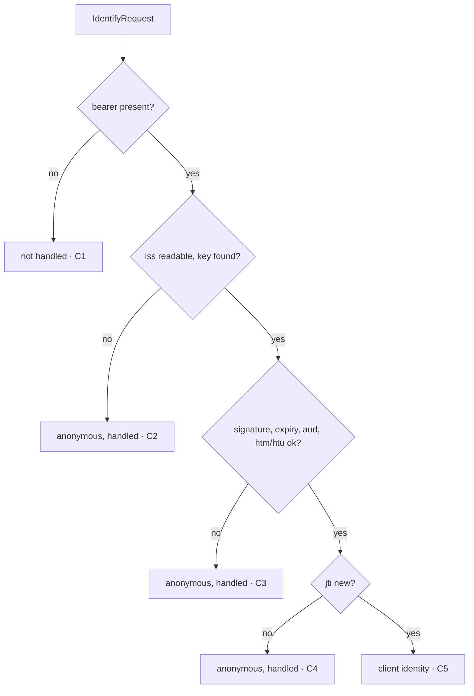

> This plan is dispatched via the CodeJob workflow. See skill: agents-workflow.

# Plan — auth: bank-grade sessions, passkeys and machine principals

Read `AGENTS.md` first. Master plan: `SECURITY_BY_DEFAULT_MASTER_PLAN.md` in
the maintainer's workspace (not published; everything you need is restated
here).

## Why

An audit of `veltylabs/iam`, the identity provider of the ecosystem, found:

| # | Problem | Fixed by stage |
|---|---|---|
| F3 | iam uses `session/jwt`: stateless, 7 days, **logout cannot revoke**. The opaque cookie session has sliding idle (`IdleTTL`) but **no absolute cap**: an active session lives forever. | 2 |
| F1 | The admin plane shares the `.velty.cl` SSO cookie, so any sibling subdomain's server receives it. Admin sessions must be **host-only** (`__Host-`) and separate. | 2, 3 |
| F5 | Admins log in with one factor. A **passkey** step-up is required (PCI DSS 4.0 req. 8.4.2, NIST SP 800-63B AAL3). | 3, 4 |
| F6 | Machine clients send a shared secret in a JSON body. They must authenticate with **`private_key_jwt`** (RFC 7523) and become principals usable with `router`'s `.Requires`. | 5 |
| F4 | `DEV_AUTOLOGIN` is compiled into every build unless `-tags prod` is passed, **and no build passes it**. Debug features must be opt-in (`-tags dev`). | 1 |

Targets:
- OWASP ASVS 4.0 L3: V3.3.1 (logout invalidates server-side), V3.3.2
  (re-authentication period), V3.4.4 (`__Host-` cookie prefix), V2 (MFA).
- NIST SP 800-63B §7.2: AAL2 re-auth 12 h / 30 min idle; AAL3 12 h / 15 min idle.
- PCI DSS 4.0 req. 8.2.8: 15 min idle.

## Dependencies (all must be tagged before you start; if any is missing, stop)

| Module | Needed symbol |
|---|---|
| `webtyp.com/model` | `model.Assurance` (`AssuranceNone`, `AssuranceSingleFactor`, `AssuranceMultiFactor`) |
| `webtyp.com/router` | `Context.SetAssurance/Assurance`, `Route.RequiresMFA()`, `router.HeaderWWWAuthenticate`, `router.ChallengeMFARequired` |
| `webtyp.com/jwt` | `jwt.UnverifiedAssertionIssuer`, `jwt.VerifyClientAssertion`, `jwt.ClientAssertion`, `jwt.FromBearer` |
| `webtyp.com/webauthn` | package `webauthn/server`: `RelyingParty`, `VerifyRegistration`, `VerifyAssertion`, `UnverifiedCredentialID`, `StoredCredential`, `Registration` |
| `webtyp.com/crypto` | `rand.Bytes` (exists) |

`go get webtyp.com/model@latest webtyp.com/router@latest webtyp.com/jwt@latest webtyp.com/webauthn@latest webtyp.com/crypto@latest`.

## Constraints (from AGENTS.md, restated)

- Parts compile to WASM (TinyGo, Cloudflare Workers). **No `map`**, **no
  reflection** (no `errors.Is/As`, no `==` between interface values: detect
  sentinels with `IsX(err)` helpers), **`webtyp/fmt`** instead of
  `fmt`/`strconv`/`strings`.
- Persistence only through `webtyp.com/orm`. Models are declared in a
  `models.go` and their `models_orm.go` is **generated** by `ormc` (`go install
  webtyp.com/orm/cmd/ormc@latest`, then run `ormc` at the package root, as the
  existing `models_orm.go` header says). Never hand-edit `models_orm.go`.
- Tests in `tests/` (external package). Never export a symbol for a test.
  Run `gotest`.
- Every repeated string is a named constant. Error texts are constants.

## Design gate

1. **Prior art.**
   - *Sessions:* Django (`SESSION_COOKIE_AGE` + custom idle middleware),
     Rails (`expire_after` + absolute via `devise :timeoutable`), ASP.NET Core
     (`ExpireTimeSpan` + `SlidingExpiration`, absolute via
     `AbsoluteExpiration`). All keep server-side revocable sessions with both
     limits. Here each session **row** carries its own policy, so two
     policies (SSO and admin) share one table and every Worker isolate agrees
     without shared memory.
   - *Step-up:* GitHub "sudo mode", AWS console re-auth, RFC 9470. A separate
     short-lived elevated session issued after a stronger factor.
   - *Machine principals:* Google service accounts, AWS IAM roles, Kubernetes
     ServiceAccounts. The client is an identity, and the same policy engine
     authorizes it.
   - *DEV switch:* Go's own convention of build tags for debug-only code;
     `webtyp/app` already compiles the client with `-tags dev`.
2. **Novice names.**
   - `auth.SessionPolicy{Absolute, Idle, Assurance}`;
   - `auth.Principal{UserID, Assurance, IssuedAt}` ("principal" is the industry word for the authenticated subject: Java/Spring `Principal`; `Identity` is already the provider-link model);
   - `cookie.New(repo, cookie.Options{Name, Domain, Policy, TrustProxy})`;
   - `authority.Module.SetStepUpStrategy(s)` and `IssueStepUpSession(ctx, userID)`;
   - `passkey.New(...)`, `clientassertion.New(...)`.
   - Each reads as a sentence. No abbreviations.
3. **Complexity ledger.**
   - Concepts: +3 (`SessionPolicy`, step-up session, request identifier),
     −1 (`session/jwt` deleted).
   - Ways to carry a session: 2 → 1 (cookie only).
   - Ways to authenticate a machine client: shared secret (in iam) → private
     key only, so 0 net.
   - Call sites: the composition root gains ~6 lines for passkeys and step-up.
     Apps that do neither change one line (`cookie.New` options).
4. **Where it belongs.** Sessions, authenticators and step-up are
   authentication, which is this library. Verifying a passkey response is
   `webauthn/server`. Verifying a JWT is `jwt`. Authorization stays in `rbac`.
   Route enforcement stays in `router` implementers.
5. **What it deletes.**
   - `session/jwt` (iam was its only consumer and migrates in the same wave).
   - The `!prod` build tag.
   - The "IdleTTL supersedes TokenTTL" semantics: TokenTTL becomes the
     absolute cap. **Behavior change for `mjosefa-cms`**: its sessions, today
     unbounded while active, are capped at `TokenTTL` (default 24 h). Intended.

## Stage 1 — DEV_AUTOLOGIN becomes opt-in

1. `authority/devlogin.go`: `//go:build !prod` → `//go:build dev`.
2. `authority/devlogin_prod.go`: `//go:build prod` → `//go:build !dev`. Rename
   the file to `authority/devlogin_off.go`. Update comments ("production
   builds" → "every build without `-tags dev`").
3. `tests/dev_autologin_test.go`: add `//go:build dev` as the first line.
4. New `tests/dev_autologin_off_test.go` with `//go:build !dev`: with
   `DEV_AUTOLOGIN` set (use the same env seam the existing test uses) and a
   `local` authenticator enabled, an unauthenticated request through
   `Authenticate()` stays anonymous.
5. `user.go` comment on `EnvDevAutologin`: "honored only in builds with
   `-tags dev`".
6. `README.md` section "Development auto-login": state that the dev server
   must be built with `-tags dev` (the `webtyp` dev environment does this),
   and that any other build ignores the variable.

`gotest` runs one extra pass with `-tags dev` when a module contains
`//go:build dev` files (devflow change shipped by the planner). Both test
files therefore run.

## Stage 2 — session policy, identity, revocation

### 2.1 Types (`user.go`)

```go
// SessionPolicy is how long a session lives and how strongly it was proven.
// Each session row stores its own policy, so different strategies can share
// one session table.
type SessionPolicy struct {
	Absolute  int             // seconds from creation; the hard cap. Required (> 0).
	Idle      int             // seconds without activity; 0 = no idle limit
	Assurance model.Assurance // what a session issued under this policy proves
}

// Principal is who a request is, and how strongly that was proven. (The name
// Identity is taken: it is the provider-link model of the "identity" table,
// which must NOT be renamed — its ModelName is a table name.)
type Principal struct {
	UserID    string
	Assurance model.Assurance
	IssuedAt  int64 // unix seconds the session was created; 0 for request credentials
}
```

Constant: `ErrMsgPolicyAbsolute = "auth: SessionPolicy.Absolute must be > 0"`.

`SessionStrategy` becomes:

```go
type SessionStrategy interface {
	Issue(ctx router.Context, userID string) error
	Identify(ctx router.Context) (Principal, error) // zero Principal only with a non-nil err
	Revoke(ctx router.Context) error
}
```

`SessionRepo` becomes:

```go
type SessionRepo interface {
	CreateSession(userID, ip, userAgent string, p SessionPolicy) (Session, error)
	GetSession(id string) (Session, error) // applies the row's own policy; slides idle
	DeleteSession(id string) error
}
```

### 2.2 Model (`models.go`, then regenerate `models_orm.go` with `ormc`)

`Session` gains three columns (keep the existing ones):
- `AbsoluteAt int64`: `CreatedAt + Absolute`;
- `IdleSeconds int64`: the policy's `Idle`;
- `Assurance int64`: `int64(model.Assurance)`.

`ExpiresAt` keeps its meaning: the current sliding expiry, equal to
`min(now+Idle, AbsoluteAt)`, or `AbsoluteAt` when `Idle == 0`.

### 2.3 `authority/sessions.go`

- `CreateSession(userID, ip, ua, p)`: `p.Absolute <= 0` → error
  `ErrMsgPolicyAbsolute`. Set `CreatedAt=now`, `AbsoluteAt=now+p.Absolute`,
  `IdleSeconds=p.Idle`, `Assurance=p.Assurance`, `ExpiresAt` as above.
- `GetSession(id)`: expired when `now >= ExpiresAt` **or** `now >= AbsoluteAt`
  → delete row + cache entry, return `auth.ErrSessionExpired`. Otherwise
  slide: `newExpiry = min(now+IdleSeconds, AbsoluteAt)` when `IdleSeconds > 0`.
  Persist only if `newExpiry - ExpiresAt >= slideWriteThreshold` (constant 60
  seconds, so a burst of requests does not write every time). Keep the
  existing "slide not persisted" log.
- Delete `slideSession`'s dependency on `m.config.IdleTTL`: the row carries
  its policy.
- `auth.Config` comments: `TokenTTL` = **absolute** lifetime of the default
  strategy's sessions (default 86400); `IdleTTL` = idle limit within it (0 =
  none). They build the default policy
  `SessionPolicy{Absolute: TokenTTL, Idle: IdleTTL, Assurance: model.AssuranceSingleFactor}`.

### 2.4 `session/cookie/cookie.go`

```go
// Options configures a cookie session strategy.
type Options struct {
	Name       string             // cookie name; "" = "session"
	Domain     string             // "" = host-only, and the name gets the __Host- prefix
	Policy     auth.SessionPolicy // required: Absolute > 0
	TrustProxy bool
}

// New builds a cookie strategy. With Domain == "" the cookie is host-only and
// named "__Host-"+Name: the browser then refuses any attempt by another
// subdomain to set or shadow it (RFC 6265bis). With Domain set (e.g.
// ".velty.cl") the session is shared by every subdomain: use that only for a
// single-factor SSO identity, never for a privileged session.
func New(repo auth.SessionRepo, o Options) (*Strategy, error) // error when Policy.Absolute <= 0
```

- Constant `hostPrefix = "__Host-"`.
- `Issue`: `repo.CreateSession(userID, ip, ua, s.policy)`. Cookie:
  `HttpOnly`, `Secure`, `SameSite=Strict`, `Path="/"`, `MaxAge = policy.Absolute`,
  `Domain = o.Domain` (only when set).
- `Identify`: returns
  `auth.Principal{UserID: sess.UserId, Assurance: model.Assurance(sess.Assurance), IssuedAt: sess.CreatedAt}`.
- `Revoke`: delete the row, and clear the cookie with the **same name, Path
  and Domain**. A cookie set with a Domain cannot be cleared without it, and
  today's `Revoke` omits it.
- `authority/module.go`: the default strategy becomes
  `cookie.New(m, cookie.Options{Name: cfg.CookieName, Policy: <default policy from 2.3>, TrustProxy: cfg.TrustProxy})`.
  Handle the error in `authority.New`. Note: the default cookie is now
  host-only and named `__Host-<name>`. Existing sessions are dropped once on
  deploy, which is acceptable for a security upgrade. Say so in `README.md`.

### 2.5 Delete `session/jwt`

Delete the directory `session/jwt/`, its tests, and every mention (`user.go`
doc of `SessionStrategy`, `authority/module.go` `SetStrategy` doc,
`oauth2/oauth.go` comment, `README.md` "Packages").
`grep -rn "session/jwt\|sessionjwt" .` → empty.

## Stage 3 — step-up strategy and request identifiers (`authority`)

1. `user.go`:
   ```go
   // RequestIdentifier is an Authenticator that identifies a request from a
   // credential it carries (a header), not from a session. handled == true
   // means the request presented this kind of credential: the result (which may
   // be the zero Principal, if the credential was invalid) is final and no
   // session cookie is consulted.
   type RequestIdentifier interface {
   	IdentifyRequest(ctx router.Context) (p Principal, handled bool)
   }
   ```
2. `authority.Module`:
   - field `stepUp auth.SessionStrategy`;
   - `func (m *Module) SetStepUpStrategy(s auth.SessionStrategy)`: sessions
     proven by a second factor. Call before mounting; nil is ignored, like
     `SetStrategy`;
   - `func (m *Module) IssueStepUpSession(ctx router.Context, userID string) error`:
     returns `ErrNoStepUpStrategy` (new error constant
     `"auth: no step-up strategy configured"`) when `stepUp == nil`;
   - `func (m *Module) CurrentPrincipal(ctx router.Context) (auth.Principal, error)`:
     runs the same resolution as `Authenticate` (below) without touching
     `ctx`. Used by `passkey` to read `IssuedAt`.
3. `authority/middleware.go` `Authenticate()` resolution order (see diagram):
   1. every enabled authenticator implementing `auth.RequestIdentifier`, in
      `Enable` order. The first with `handled == true` decides, even if
      anonymous;
   2. `m.stepUp` (if set) `Identify` OK → that identity;
   3. `m.strategy.Identify` OK → that identity;
   4. dev autologin (only compiled with `-tags dev`) → `Principal{UserID, Assurance: SingleFactor}`;
   5. anonymous.

   Then `ctx.SetUserID(id.UserID)` and `ctx.SetAssurance(id.Assurance)`.
4. `authority/mount.go` logout: revoke `m.stepUp` (if set) **and**
   `m.strategy`. Logout must kill both.

## Stage 4 — `auth/passkey` (new package)

Ports it receives (all implemented by `*authority.Module`; declare a narrow
interface in the package, per the existing "mode asks only for the ports it
needs" pattern):

```go
type Sessions interface {
	CurrentPrincipal(ctx router.Context) (auth.Principal, error)
	IssueStepUpSession(ctx router.Context, userID string) error
	Notify(e auth.SecurityEvent)
}
```

Constructor:

```go
// New builds the passkey authenticator. db stores credentials and challenges;
// rp is who the passkeys are for (ID "iam.velty.cl", Origin "https://iam.velty.cl").
func New(db *orm.DB, ids model.IDGenerator, sessions Sessions, rp server.RelyingParty) (*Module, error)
```

It implements `auth.Authenticator` (`Name() = "passkey"`, `Mount(r)`).

Models (`passkey/models.go` + generated `passkey/models_orm.go`):
- `PasskeyCredential{Id string /*base64url credential id*/, UserId string, PublicKey string /*base64url SPKI*/, SignCount int64, CreatedAt int64, LastUsedAt int64}`;
- `PasskeyChallenge{Id string /*base64url challenge*/, UserId string, Purpose string, ExpiresAt int64}`.
  `Purpose` is `purposeRegister = "register"` or `purposeVerify = "verify"`.
  Challenges are single-use, deleted on first read, and live 300 s
  (`challengeTTL = 300`). Challenge bytes: 32 from `crypto/rand`.

A `Migrate`-style schema creation like the existing authority models (copy
how `authority` creates its tables).

Routes (constants), all registered by `Mount`:

| Path | Access | Behavior |
|---|---|---|
| `PathRegisterOptions = "/passkey/register/options"` | `.Authenticated()` | enrollment gate (below). Then JSON `{challenge, rpId, userId, userName, excludeCredentials[]}` |
| `PathRegister = "/passkey/register"` | `.Authenticated()` | enrollment gate again; consume the `register` challenge for this user; `rp.VerifyRegistration`; store; event `EventPasskeyRegistered` |
| `PathVerifyOptions = "/passkey/verify/options"` | `.Authenticated()` | JSON `{challenge, rpId, allowCredentials[]}` of this user. 404 when the user has no passkey |
| `PathVerify = "/passkey/verify"` | `.Authenticated()` | `server.UnverifiedCredentialID` → load the credential **of this user** (another user's id → 403 + `EventPasskeyRejected`); consume the `verify` challenge; `rp.VerifyAssertion`; update `SignCount`/`LastUsedAt`; `sessions.IssueStepUpSession(ctx, userID)`; event `EventPasskeyVerified`; 204 |
| `PathList = "/passkey/list"` | `.Authenticated().RequiresMFA()` | the user's credentials (id, created, last used) |
| `PathDelete = "/passkey/delete"` | `.Authenticated().RequiresMFA()` | delete one of the user's credentials by id; event `EventPasskeyDeleted` |

**Enrollment gate** (closes "a stolen SSO cookie enrolls the attacker's
passkey"):
- If the user already has ≥1 credential: require
  `ctx.Assurance() == model.AssuranceMultiFactor`. Otherwise answer 401 with
  `router.HeaderWWWAuthenticate: router.ChallengeMFARequired`.
- If the user has 0 credentials: require
  `now - CurrentPrincipal(ctx).IssuedAt <= freshLoginWindow` (constant 300 s).
  Otherwise answer 401 with header value constant
  `ChallengeRecentLogin = Bearer error="insufficient_user_authentication", error_description="sign in again to enroll a passkey", max_age=300`
  (RFC 9470 `max_age`).

Events: add to the `user.go` event enum and its `String()`:
`EventPasskeyRegistered`, `EventPasskeyVerified`, `EventPasskeyRejected`,
`EventPasskeyDeleted`, `EventClientAssertionRejected`.

Any verification error from `webauthn/server` → 401, body empty, event
`EventPasskeyRejected` with the error text in the event's detail field (use
whatever field `SecurityEvent` has for a reason).

## Stage 5 — `auth/clientassertion` (new package)

```go
// ClientKeys returns the registered P-256 public key (SPKI DER) of an active
// client. An unknown or inactive client is an error.
type ClientKeys interface {
	ClientPublicKey(clientID string) ([]byte, error)
}

// New builds the authenticator. audience is this server's identifier, e.g.
// "https://iam.velty.cl": assertions must name it in aud, and htu must be
// audience+path. notify may be nil.
func New(db *orm.DB, keys ClientKeys, audience string, notify func(auth.SecurityEvent)) (*Authenticator, error)
// error ErrMsgEmptyAudience = "clientassertion: audience is required" when audience == ""
```

It implements `auth.Authenticator` (`Name() = "client_assertion"`, `Mount`
registers nothing) and `auth.RequestIdentifier`.

Model `ClientAssertionJti{Id string /* iss + ":" + jti */, ExpiresAt int64}`
(+ generated orm file and table creation).

`IdentifyRequest(ctx)`:
1. `token, ok := jwt.FromBearer(ctx.GetHeader("Authorization"))`. No bearer →
   `(Principal{}, false)`: not this kind of request.
2. From here on, `handled = true`. Every failure returns `(Principal{}, true)`
   and notifies `EventClientAssertionRejected` with one of these reasons
   (constants): `reasonMalformed`, `reasonUnknownClient`, `reasonSignature`,
   `reasonExpired`, `reasonAudience`, `reasonBinding`, `reasonReplay`.
3. `iss, err := jwt.UnverifiedAssertionIssuer(token)` → `reasonMalformed`.
4. `key, err := keys.ClientPublicKey(iss)` → `reasonUnknownClient`.
5. `a, outcome, err := jwt.VerifyClientAssertion(key, token)`: `err != nil` or
   `Forged` → `reasonSignature`; `Expired` → `reasonExpired`.
6. `a.Aud != audience` → `reasonAudience`.
7. `a.Htm != ctx.Method()` or `a.Htu != audience+ctx.Path()` → `reasonBinding`.
8. Delete rows with `ExpiresAt < now` (housekeeping, ignore its error), then
   insert `ClientAssertionJti{Id: iss+":"+a.Jti, ExpiresAt: a.Exp}`. An insert
   error (duplicate primary key) → `reasonReplay`.
9. `(Principal{UserID: iss, Assurance: model.AssuranceSingleFactor}, true)`.

No per-client lockout, on purpose: there is no guessable secret, and a lockout
keyed on `client_id` would let anyone deny service to a legitimate client by
sending bad assertions with its id. Write this rationale in the package doc.

## Branch diagrams









| Branch | Test file → case |
|---|---|
| A1 | `tests/authenticate_order_test.go`: a fake RequestIdentifier returning `handled=true` with zero identity wins over a valid session cookie |
| A2 | step-up cookie + main cookie → identity from step-up, `MultiFactor` |
| A3 | main cookie only → `SingleFactor` |
| A4 | `tests/dev_autologin_test.go` (`-tags dev`), existing |
| A5 | no credentials → anonymous; and `tests/dev_autologin_off_test.go` (`!dev`) |
| S1 | `tests/session_policy_test.go`: idle elapsed → expired; absolute elapsed while active → expired |
| S2 | access after 61 s with Idle 900 → row `ExpiresAt` moved, never beyond `AbsoluteAt` |
| S3 | access after 10 s → row unchanged |
| policy refusals | `CreateSession` with `Absolute 0` → error; `cookie.New` with `Absolute 0` → error |
| cookie shape | `tests/cookie_options_test.go`: Domain "" → name `__Host-x`, no Domain attribute; Domain ".velty.cl" → name `x`, Domain set; `Revoke` clears with the same name and Domain |
| logout | `tests/logout_test.go`: both step-up and main rows deleted |
| K1–K6 | `tests/passkey_test.go`: build real registration/assertion responses with `asym.GenerateKeyPair` exactly as `webauthn/server` tests do (copy the envelope helpers into the test file); drive the real `authority.Module` + `passkey.Module` over `router/mock` |
| list/delete need MFA | `PathList` with a single-factor session → 401 + challenge (enforced by the mock router) |
| C1–C5 | `tests/clientassertion_test.go`: real `jwt.NewClientAssertion` + `SignClientAssertion`; a fake `ClientKeys`; `orm` over `storage/mem`. Cases: no header; unknown iss; key mismatch; expired; wrong aud; wrong method; wrong path; replay (same token twice → second anonymous); valid → `ctx.UserID() == clientID` and `Assurance == SingleFactor` |
| cookie ignored on machine request | valid session cookie + invalid bearer → anonymous (handled) |

Write each test before the code it covers and confirm it fails for the right
reason. Branch coverage of `authority/middleware.go`, `authority/sessions.go`,
`session/cookie`, `passkey`, `clientassertion`: **100%**.

## Stages

| # | Files | Done when |
|---|---|---|
| 1 | `authority/devlogin.go`, `authority/devlogin_off.go` (renamed from `devlogin_prod.go`), `tests/dev_autologin_test.go`, `tests/dev_autologin_off_test.go`, `user.go` | A4/A5 green in both tag passes |
| 2 | `user.go`, `models.go`, `models_orm.go` (regenerated), `authority/sessions.go`, `authority/module.go`, `session/cookie/cookie.go`, delete `session/jwt/`, `oauth2/oauth.go` (comment), `tests/session_policy_test.go`, `tests/cookie_options_test.go` | S1–S3, cookie shape green; `session/jwt` gone |
| 3 | `user.go`, `authority/module.go`, `authority/middleware.go`, `authority/mount.go`, `tests/authenticate_order_test.go`, `tests/logout_test.go` | A1–A3 green |
| 4 | `passkey/passkey.go`, `passkey/routes.go`, `passkey/models.go`, `passkey/models_orm.go`, `user.go` (events), `tests/passkey_test.go` | K1–K6 green |
| 5 | `clientassertion/clientassertion.go`, `clientassertion/models.go`, `clientassertion/models_orm.go`, `tests/clientassertion_test.go` | C1–C5 green |
| 6 | `README.md` (Packages: add `passkey`, `clientassertion`, remove `session/jwt`; a "Bank-grade setup" example composition root: SSO cookie strategy with Domain, step-up host-only strategy 15 min idle / 8 h absolute, passkey, client assertion), `docs/` architecture doc if one describes sessions | docs match code |

Existing tests that call `cookie.New(repo, name, ttl, trustProxy)`,
`CreateSession(userID, ip, ua)` or the old `Identify` signature are updated
mechanically to the new signatures. Do not delete them.

## Acceptance criteria

- `gotest` green (both the default and the `-tags dev` pass, stdlib and WASM).
- `grep -rn "go:build prod\|go:build !prod" .` → empty.
- `grep -rn "session/jwt\|sessionjwt" .` → empty.
- `grep -rn "map\[" passkey/ clientassertion/ session/ authority/middleware.go` → no new hits.
- Before opening the PR: `git diff --stat main` lists every file of the
  stages table, and no file is deleted that this plan does not order deleted
  (the only ordered deletion is `session/jwt/`, plus the rename of
  `devlogin_prod.go`).
