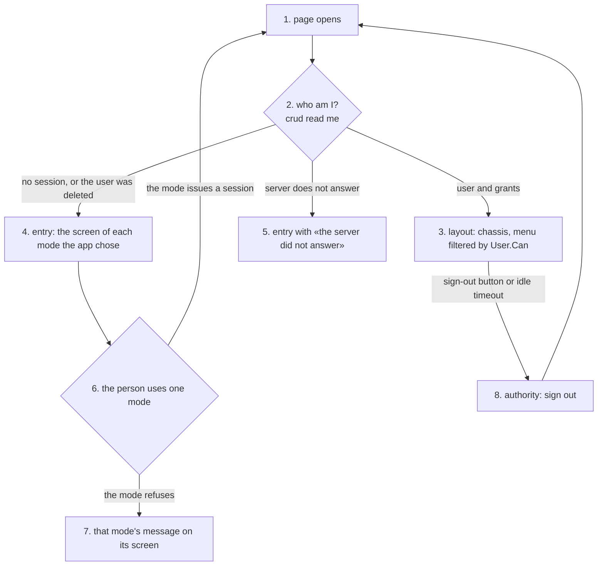

# Sign-in — one piece, end to end

**Context.** Each app chooses, in its appkit configuration, which sign-in modes it offers. A mode is an `auth.Mode` value
(`trustedip.Mode{Devices}`, `passkey.Mode{Origin}`); `Build(auth.Ports)` turns it into the `auth.Authenticator` that
serves its routes. `appkit` never knows which modes exist: it builds `authority`, adds to `authority.Ports()` what only
it can give (`MakeAdmin`, `HasAdmin`, `Built`), builds each chosen mode and mounts it. With no mode the app has no
sign-in: it starts, says so, and every guarded operation is denied. Each mode owns its two halves: the routes it serves and the browser screen that calls them.
`authority` owns what every mode shares: who the caller is, the session, and signing out. The layout receives only the
result inside `view.Session` and never names a route, an operation or `auth`.

| Piece | Knows | Never knows |
|---|---|---|
| app (`config/`) | which modes it offers, and their settings | routes, operations, profile shape |
| `authority` | session cookie, crud read `me`, `/logout`, the grant «every signed-in person reads `me`» | which modes exist |
| each mode (`auth.Authenticator`) | its own routes and its own browser screen | other modes, layout |
| `appkit` | builds `authority`, gives each chosen mode its ports, fills `view.Session` | any mode by name, routes, status codes |
| `layout` | `view.Session.User`, `SignOut`, the entry screens of the chosen modes | `auth`, routes, operations |

## Walkthrough

1. **Page opens.** `browser.Run` builds the session before the layout draws anything.
2. **Who am I.** One crud read of `me` through the app's `Caller`, the same for every mode. Allowed by a grant that
   `authority` declares itself (`DefaultGrants`) and appkit applies like any module's.
3. **Signed in.** `view.Session.User` carries id, name, avatar and grants; the menu shows only what `User.Can` allows.
4. **Not signed in.** The layout shows the entry screens of the modes the app chose that are open at this door, in the
   app's order: each mode asks its own route (`trusted_ip` answers 404 from the Internet). A session whose
   user was deleted counts as not signed in.
5. **Server down.** Never mistaken for «not signed in»: the entry says the server did not answer and what to do.
6. **A mode signs the person in.** What it asks for (a key, a passkey, a Google account) and its extra steps (the first
   administrator of `trusted_ip`, enrolling a passkey) live inside the mode, never in this flow. On success the mode
   issues the session through `authority` and the page restarts at 1.
7. **A mode refuses.** The mode shows its own message; the flow does not interpret status codes.
8. **Sign out.** The layout calls `Session.SignOut`; `authority` ends the session for any mode and the page restarts at 1.

## Branches to test (one test each, before the code)

Tests of the shared flow use a fake mode at the edge; each real mode tests its own steps in its package.

| # | Setup | Expected |
|---|---|---|
| 3 | session of an existing user with grant `patient:r` | `User.ID` set, `User.Can("patient", Read)` true, `User.Can("staff", Read)` false |
| 4 | no session; app chose two modes, one closed at this door | entry shows only the open one |
| 4 | session of a deleted user | entry screens, no chassis |
| 5 | caller fails with a transport error | server-down message, no entry form |
| 6 | the fake mode issues a session | next `me` read answers that user |
| 7 | the fake mode refuses | its message on its screen, no session |
| 8 | sign out | next `me` read refused, entry screens |
| — | app chose no mode | appkit starts, logs that nobody can enter, every guarded operation is denied |
| 6 | passkey, no administrator yet | the server logs a one-time code; the right code enrolls the passkey and creates the administrator; five wrong codes lock the setup |
